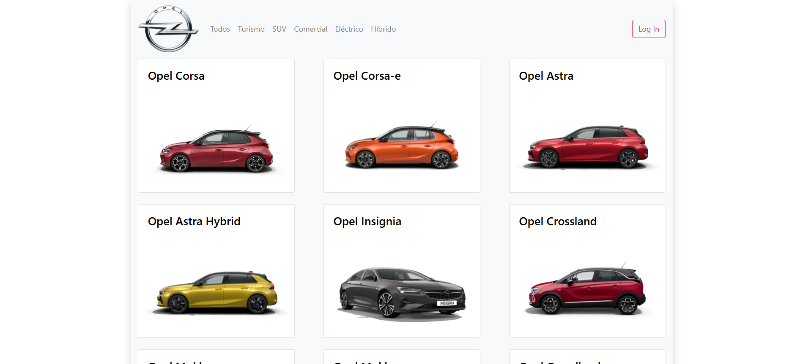
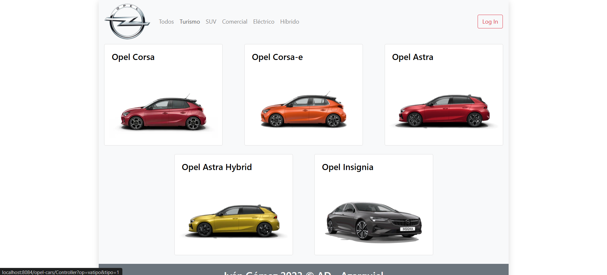
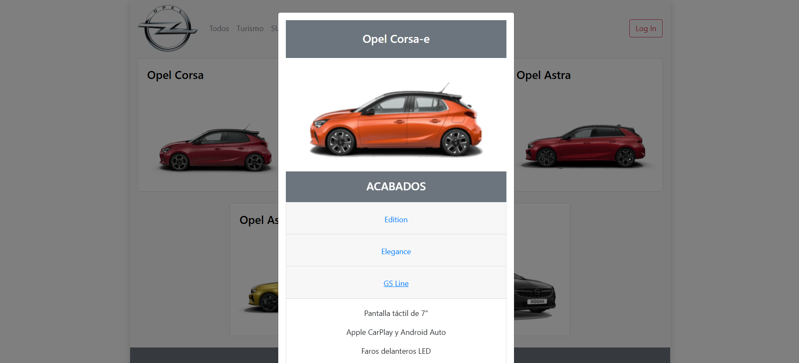
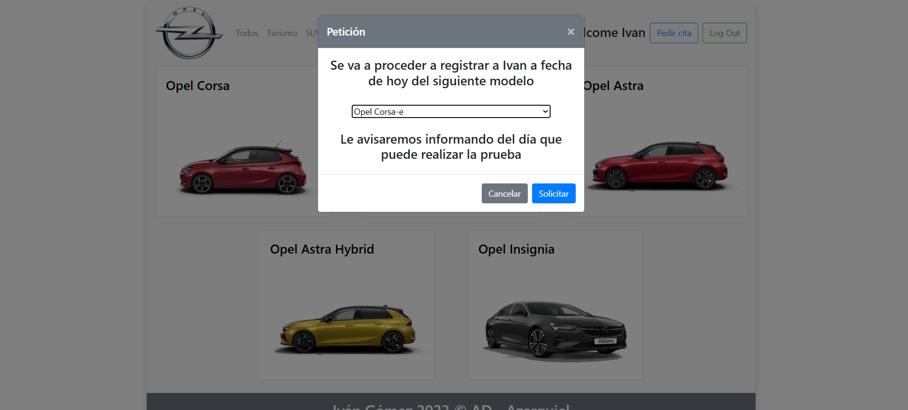
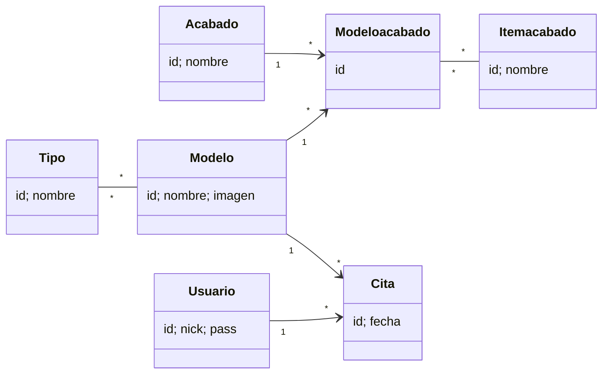

# 🚗 Opel Cars — Car Catalogue and Test-Drive Booking (Java EE + JPA)

A web application for an Opel car catalogue. Users can browse models by type, check the trim levels of each model with their equipment, and book a test-drive appointment once logged in.

> 🎓 **Academic project.** Built as the exam project for the **Data Access** module (*Acceso a Datos*) of the **Higher National Diploma in Multiplatform Application Development** (*CFGS Desarrollo de Aplicaciones Multiplataforma, DAM*), 2nd year.

---

## 📸 Screenshots

| Catalogue | Filter by type |
|---|---|
|  |  |

| Trim levels | Test-drive booking |
|---|---|
|  |  |

---

## ✨ Features

- **Model catalogue** with images, filterable by type from the navigation bar: Saloon, SUV, Commercial, Electric and Hybrid.
- **Trim levels popup**: each model shows its trim levels (Edition, Elegance, GS Line, Ultimate) and the equipment included in each one, loaded with **AJAX** without reloading the page.
- **Login & register in one step**: if the nickname doesn't exist, a new user is created.
- **Test-drive booking**, available only to logged-in users.
- **Zero setup**: an embedded H2 database is created and filled automatically on startup.
- Responsive layout with **Bootstrap 4**.

---

## 🧰 Tech Stack

| Layer | Technology |
|---|---|
| Language | Java |
| Persistence | **JPA 2.1** (EclipseLink) with `@NamedQuery`, `@OneToMany`, `@ManyToOne` and `@ManyToMany` |
| Database | **H2** embedded in-memory |
| Web | Servlets (front controller) + JSP |
| Frontend | HTML, CSS, Bootstrap 4, jQuery, AJAX |
| Server | Apache Tomcat |
| IDE / build | NetBeans (Ant) |

---

## 🏗️ Architecture

MVC with a single **front controller** servlet (`Controller`) that routes on the `op` parameter:

| `op` | Action |
|---|---|
| `inicio` | Loads all models and types and shows the home page |
| `vatipo` | Filters the catalogue by type |
| `acabados` | Returns the trim levels and equipment of a model (AJAX fragment) |
| `login` / `logout` | Session management (login or register) |
| `cita` | Books a test-drive appointment for the logged-in user |

On startup, `JPAUtil` creates the `EntityManagerFactory`, JPA generates the tables from the entities (`drop-and-create`), and the database is filled with types, models, trim levels, equipment, users and sample appointments.

### Domain model



---

## 📁 Project Structure

```
opel-cars-jpa/
├── src/
│   ├── conf/persistence.xml       # JPA + H2 configuration
│   └── java/
│       ├── controller/Controller.java
│       ├── entities/              # JPA entities
│       └── util/JPAUtil.java      # EntityManagerFactory + initial data
├── web/
│   ├── home.jsp                   # Catalogue, navbar, login and booking modals
│   ├── acabados.jsp               # Trim levels fragment (AJAX)
│   ├── myjs.js · css/style.css
│   └── img/                       # Model images
├── screenshots/
└── build.xml / nbproject/
```

---

## 🚀 Running Locally

**No database setup needed.** The data is loaded automatically into an embedded H2 database every time the app starts.

### Prerequisites
- JDK 8
- Apache Tomcat 8+
- NetBeans (Java EE / Jakarta EE support)

### Steps
1. Clone the repository and open the project in NetBeans:
   ```bash
   git clone https://github.com/ivangomezr/opel-cars-jpa.git
   ```
2. Run **Clean and Build** and run it on Tomcat.
3. Open `http://localhost:8080/opel-cars/`. The entry page redirects to `Controller?op=inicio`.

**Test users:** `admin` / `admin`, `ivan` / `1234`. You can also log in with any new nickname and password; the account is created automatically.

> ℹ️ The database is in memory, so new users and appointments are reset every time the server restarts.

---

## 🙋 Author

**Iván Gómez** — [@ivangomezr](https://github.com/ivangomezr)

Developed as coursework for the *Data Access* module, DAM.
